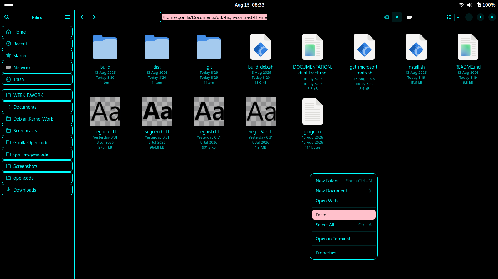
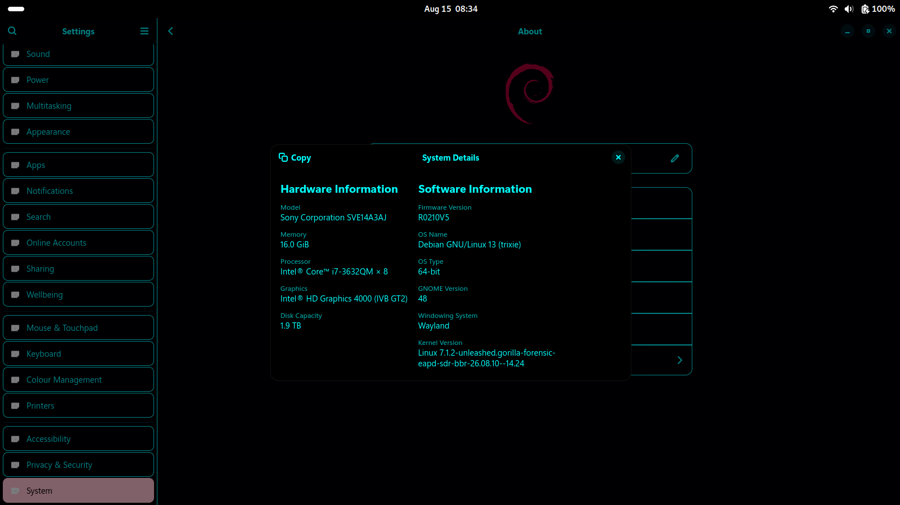
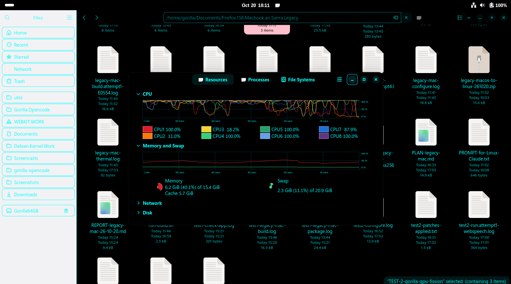
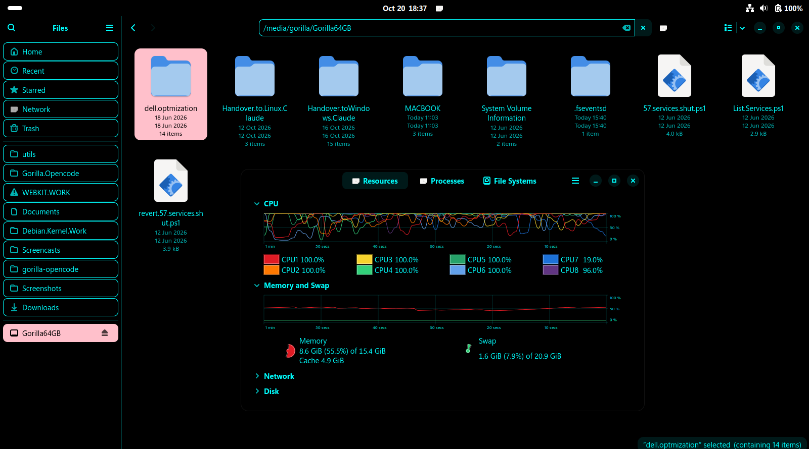
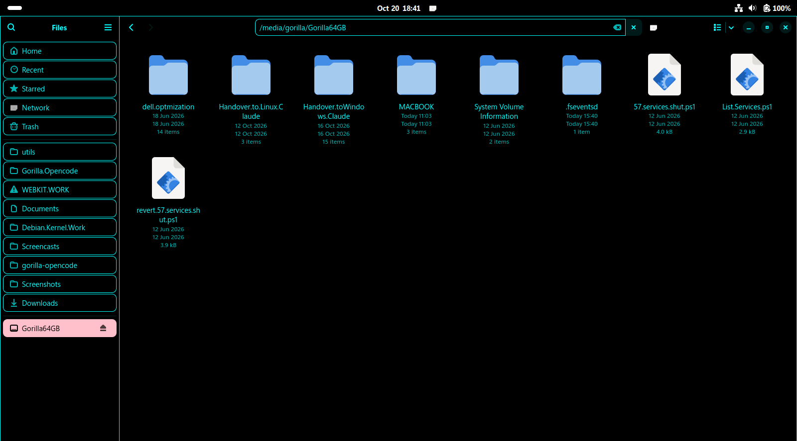
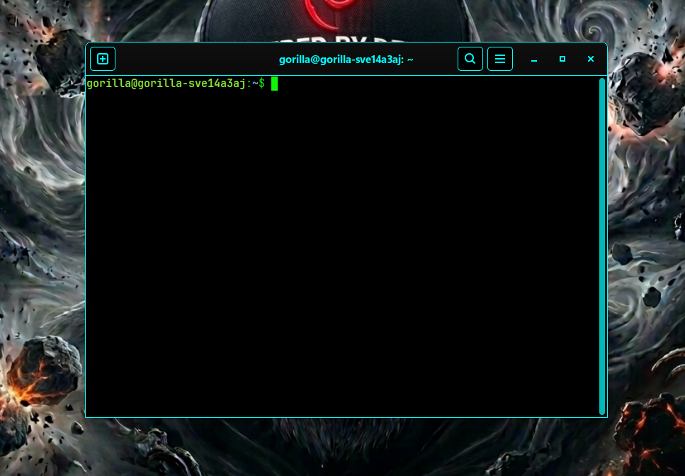
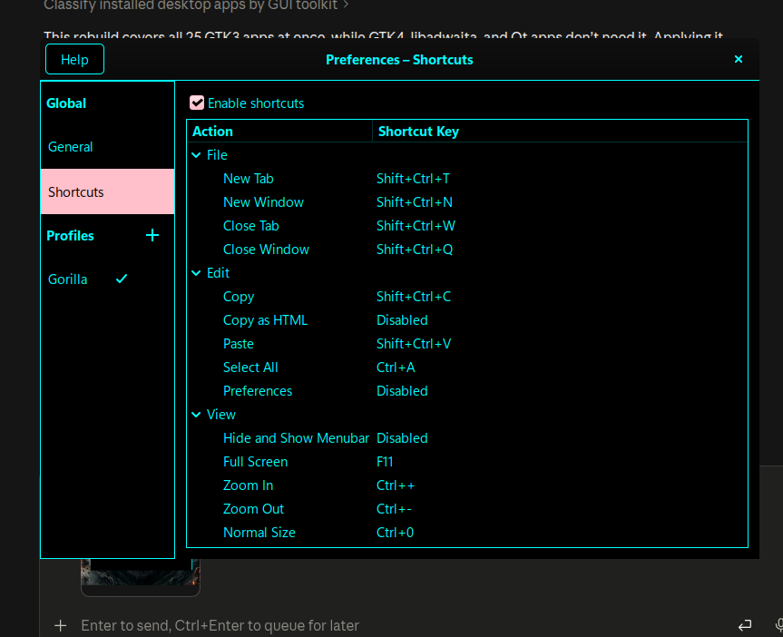
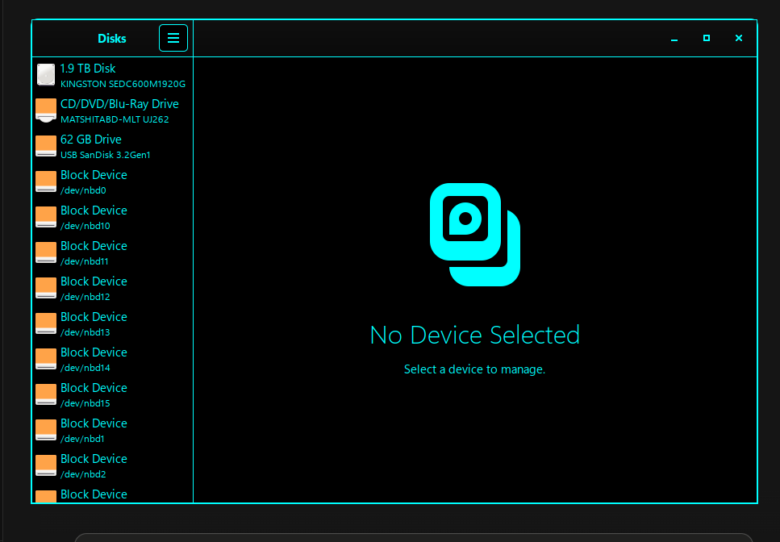

<!-- Version: 26.10.22-14-03 · updated 26-10-22-16-30 -->
# Black Gorilla Theme

<!-- WHO-THIS-IS-FOR: managed block, do not edit by hand -->

**A pure black, high contrast GTK3 and GTK4 theme, built for cheap screens and tired eyes.**

Built for the people every other tool prices out: kids with no credit
card, 15-year-old laptops, data sold by the megabyte. Free forever, by
design, not as a trial.
Why, with the numbers: [PHILOSOPHY.md](https://github.com/gorillanobakaa-dot/Gorilla.Opencode/blob/main/PHILOSOPHY.md)

<!-- /WHO-THIS-IS-FOR -->

> *Two small CSS files that make dark-theme text actually readable. No root, no
> package to install, nothing outside your home folder, one command to undo.*
>
> *Since 26.10.20-19-34 also a GTK3 theme (Adwaita rebuilt with this palette), so
> older apps like Terminal and Disks match. Still no root without the package,
> still one command to undo.*

  

---

## 📸 Screenshots (Click for Full Resolution)

<p align="center">
  <a href="screenshots/screenshot-1.png">
    
  </a>
</p>

<p align="center">
  <a href="screenshots/screenshot-2.png">
    
  </a>
</p>

**Unfocused windows (fixed 2026-10-20).** Before: with System Monitor on top, Files has lost focus and its sidebar
has turned into a light grey bar with pale text (release 26.08.15-08-17).

<p align="center">
  <a href="screenshots/unfocused-before-26.08.15.png">
    
  </a>
</p>

After: the same situation keeps the black background and full-strength cyan.

<p align="center">
  <a href="screenshots/unfocused-after-26.10.20.png">
    
  </a>
</p>

Window edges are a 1px cyan outline, the same as the path bar at rest, so a window is visible against black.

<p align="center">
  <a href="screenshots/window-edge-1px-cyan.png">
    
  </a>
</p>

**GTK3 apps (since 26.10.20-19-34).** Terminal, Disks and the other GTK3 apps draw Adwaita compiled with fixed
colours, which the CSS block above cannot reach. They now get Adwaita rebuilt from its own sources with this palette,
including the header bar, preferences and the 1px cyan window edge.

<p align="center">
  <a href="screenshots/gtk3-terminal.png">
    
  </a>
</p>

<p align="center">
  <a href="screenshots/gtk3-terminal-preferences.png">
    
  </a>
</p>

<p align="center">
  <a href="screenshots/gtk3-disks.png">
    
  </a>
</p>

---

## 🧸 Section A — For the Layman

### The problem

Open any dark-themed GNOME app and look at the small grey text under a heading —
a setting's description, a caption, a greyed-out menu item, or a right-click context
menu on a black background. On an older laptop screen, or at night, or if you're
over about forty, it's a strain to read.

That isn't your eyes. It's measurable. Here is what the standard dark theme
actually draws, measured as a **contrast ratio** (higher is easier to read; the
accessibility guidelines call 4.5 the minimum for body text and 7.0 the
comfortable target):

| What you're reading | Contrast | Verdict |
|---|---|---|
| A heading | 13.20:1 | fine |
| **The small grey description text** | **5.17:1** | *just past the legal minimum* |
| **A greyed-out menu item** | **4.58:1** | *0.08 above the minimum* |
| **Context menu borders on dark background** | **None** | *invisible floating menu* |

Those pass the test by a whisker. Passing a test and being comfortable to read
are not the same thing.

### What this does

| What you're reading | Before | After |
|---|---|---|
| Normal text | 13.20:1 | **16.75:1** |
| Small description text | 5.17:1 | **8.55:1** |
| Greyed-out items | 4.58:1 | **6.54:1** |
| Context menus & popovers | No border | **Crisp 1px cyan border** |

Deep black background, bright cyan text, pink highlights, and crisp cyan borders
around floating menus and popovers so they stand out clearly against the folder view.
It also uses the *right size* of typeface for each job — more on that below — which
is the other half of why text looks crisp rather than fuzzy.

### Install

**The easy way — download the `.deb`, double-click it.** Nothing else to do:
it applies immediately for you, and at first login for anyone else who uses the
machine. On Debian, Ubuntu, Mint and Pop!_OS you can also install it from a
terminal:

```bash
sudo apt install ./black-gorilla-theme_26.10.22-14-03_all.deb
```

**The no-package way**, if you'd rather not install anything system-wide, or
you're not on a Debian-based system:

```bash
./install.sh           # colours only
./install.sh --fonts   # colours + set the desktop font and size
```

**This changes every GTK application on your desktop**, not one app. That's the
point — but you should know it before you run it. Undo everything, including
the font settings, with:

```bash
black-gorilla-theme --revert     # if you installed the .deb
./install.sh --revert            # if you ran the script
```

Your choice is remembered. If you revert, the package will not put it back at
your next login. Removing the package (`sudo apt remove black-gorilla-theme`)
cleans it out of every account it touched, and leaves any other CSS you had in
those files alone.

Then restart an app (or log out and back in) to see the change.

**If the theme went light after a login (versions before 26.10.22-14-03).** Two login launchers could start the
theme at the same moment: ours and `gtk-high-contrast-theme.desktop`, left behind by the theme's old package name
when it was removed but not purged. Both wrote the same file at once and it came out as two mixed copies, which GTK
cannot read, so Files and Settings fell back to light Adwaita. From 26.10.22-14-03 only one run writes at a time, so
this cannot happen again. To clean up an older install:

```bash
sudo apt purge gtk-high-contrast-theme
black-gorilla-theme
```

The first removes the leftover launcher (it says "not installed" if there is none), the second rewrites your two
stylesheets once. Then close and open Files (`/usr/bin/nautilus -q` first) and Settings.

### Build the .deb yourself

```bash
./build-deb.sh
```

Produces `dist/black-gorilla-theme_26.10.22-14-03_all.deb`, about 91 KB (17 KB before the GTK3 theme). No build
dependencies beyond `dpkg-deb` — it is shell and CSS.

### Will it work on my computer?

If you run Linux with a GNOME-style desktop — Debian, Ubuntu, Fedora, Mint,
Pop!_OS, Arch — yes. It needs no special hardware and no fast machine. It was
built on a 2012 laptop and deliberately avoids anything that costs the graphics
chip work, so it does not shorten your battery life.

*Correction (2026-10-20): the battery and graphics-chip claims above and under
"Animations neutralised" are reasoning, not measurement; nothing about CPU, GPU
or battery has been measured yet (model inference). Pure black saves no power on
an LCD, only on OLED.*

---

## 💻 Section B — For the Developer

### How it works, and why it has no gaps

Two files, read automatically by GTK and loaded **after** the active theme, so
their definitions win:

```
~/.config/gtk-4.0/gtk.css   GTK4 / libadwaita applications
~/.config/gtk-3.0/gtk.css   GTK3 applications (yelp, older apps)
```

The theme does not restyle widgets. It redefines the **named colours** the
toolkit already uses everywhere:

```css
@define-color window_bg_color #000000;
@define-color view_bg_color   #000000;
@define-color card_bg_color   #000000;
@define-color accent_color    #FFC0CB;
```

Every GTK/libadwaita widget derives its colour from that small fixed vocabulary
(`window_bg_color`, `view_fg_color`, `headerbar_bg_color`, `accent_color`,
`borders`, …). Redefine a name and **every widget referencing it changes at
once — including widgets added in future toolkit versions.**

This is why the whole theme is ~25 declarations rather than thousands, and why
it has no gaps. The usual approach — chasing selectors (`button {}`,
`headerbar {}`, `.sidebar {}`) — cannot enumerate every widget, so there is
always an unstyled popover or an invisible disabled item, and a class rename in
the next release breaks whatever *was* covered. **You cannot miss a widget you
never addressed.**

Explicit selectors are used only where a colour name cannot express the rule:
focus rings, disabled-item visibility, context menu edges (`popover > contents`),
edge drawing, animation timing, unfocused windows.

**Correction (2026-10-20):** "no gaps" was wrong for unfocused windows. The
vocabulary has a second set of names for a window that has lost focus
(`sidebar_backdrop_color`, `headerbar_backdrop_color`, GTK3's `unfocused_*`),
and releases up to 26.08.15-08-17 never set them. On Alt+Tab away from Files
the sidebar turned into a light grey bar and the header bar faded to half
strength. Toolkits also dim unfocused windows with fixed greys and
`filter: opacity(0.5)`, which no colour name reaches. Fixed in 26.10.20-18-27
by naming the backdrop colours and overriding each fade by selector.

### Typography — optical sizes

Segoe UI Variable ships three faces cut for different size ranges:

| Family | Drawn for | Used here for |
|---|---|---|
| `…Static Small` | very small text | captions |
| `…Static Text` | body / UI text | everything by default |
| `…Static Display` | large text | headings, titles |

Using the right one per role is most of what makes UI text look crisp instead
of muddy.

**Getting the fonts, the honest way.** Microsoft's EULA licenses *use*, not
*redistribution* — so this repo ships the **method**, never the binaries
(`.gitignore` blocks `*.ttf`/`*.ttc`). Run:

```bash
./get-microsoft-fonts.sh
```

It pulls the fonts **from Microsoft's own free Windows 11 Enterprise 90-day
evaluation download**, on your machine, and installs them. Nothing is pirated
and nothing proprietary is redistributed by this repo. Method credit: Arch
Linux's `ttf-ms-win11-auto`.

**You do not have to run it.** `font-family` is a fallback list, so the theme
works on any machine either way:

```css
font-family: "Segoe UI Variable Static Text", "Segoe UI", Inter,
             Cantarell, "Noto Sans", "DejaVu Sans", sans-serif;
```

Segoe is used if the machine has it; otherwise the best available free face is,
automatically. Nothing to detect, nothing to break.

### Design rules

- **Outline, never border (except popovers).** A border changes box geometry and
  forces a CPU reflow on every focus change; an outline is drawn outside layout and
  composited by the GPU. Popovers use `border` because GTK's arrow node reads
  `border-bottom-width` to align with the panel.
- **`box-shadow: none` on focus and popovers.** libadwaita's stock focus ring and
  popover shadow are translucent shadows — that is exactly what makes them look
  faded on dark backgrounds. They are removed, not tinted.
- **Dim by hue, not by alpha.** Secondary text is `#00B8B8` (8.55:1), not white
  at 55% opacity (5.17:1). Transparency over black is what produces mud.
- **Animations neutralised to 0.01ms.** A styled desktop should not cost the
  graphics chip work. This matters on pre-2016 integrated GPUs.

### Verify any colour before shipping it

```bash
python3 - <<'EOF'
def L(c):
    f=lambda v:(v/255)/12.92 if v/255<=0.03928 else (((v/255)+0.055)/1.055)**2.4
    return 0.2126*f(c[0])+0.7152*f(c[1])+0.0722*f(c[2])
fg,bg=(0,255,255),(0,0,0)
print(round((max(L(fg),L(bg))+0.05)/(min(L(fg),L(bg))+0.05),2), ":1")
EOF
```

AA needs 4.5, AAA needs 7.0. Do not eyeball it — the whole reason the stock
theme is uncomfortable is that 4.58 and 8.64 look similar in a mockup and feel
nothing alike after an hour.

### Files

| File | Purpose |
|---|---|
| `install.sh` | apply / `--fonts` / `--revert` / `--check`. Idempotent. |
| `~/.config/black-gorilla-theme.state` | previous font settings, for `--revert` |

### Why this isn't a theme you select in Settings

Because that would not work, and the reason is measurable rather than a matter
of opinion. Traced with `strace` on GTK 4.18.6 / libadwaita 1.7.6:

| Application kind | Stylesheets it actually opens |
|---|---|
| Plain GTK4 | `~/.config/gtk-4.0/gtk.css` **and** `/usr/share/themes/<Name>/gtk-4.18/gtk.css` |
| libadwaita | `~/.config/gtk-4.0/gtk.css` — and nothing else. It never stats `/usr/share/themes` at all. |

Files, Settings, Software, Text Editor, Epiphany — everything modern in GNOME
is libadwaita. So a theme packaged the conventional way would install cleanly,
show up in tweak tools, and change nothing you actually look at. The per-user
file is not a shortcut taken to save effort; it is the only mechanism
libadwaita honours.

Reproduce it yourself:

```bash
strace -f -e trace=openat -o /tmp/gtk.strace gnome-text-editor & sleep 3; kill %1; grep -o '"[^"]*gtk.css"' /tmp/gtk.strace | sort -u
```

That is also why the `.deb` writes into home directories, which Debian policy
normally discourages. It is bounded: only accounts carrying this theme's own
stamp file are ever touched, and removing the package strips exactly the block
it added and nothing else.

### Known limitations

- **Electron and Qt apps are unaffected** — they do not use GTK's theme.
- **Some apps hardcode colours** and will ignore parts of this. Nothing can fix
  that from outside the app.
- **Web page content is unaffected**, by design. A browser's own interface is
  themed; the pages you visit are not.

---

*Built on a Sony VAIO SVE14A3AJ (2012) running Debian 13. Sharing is caring.*
